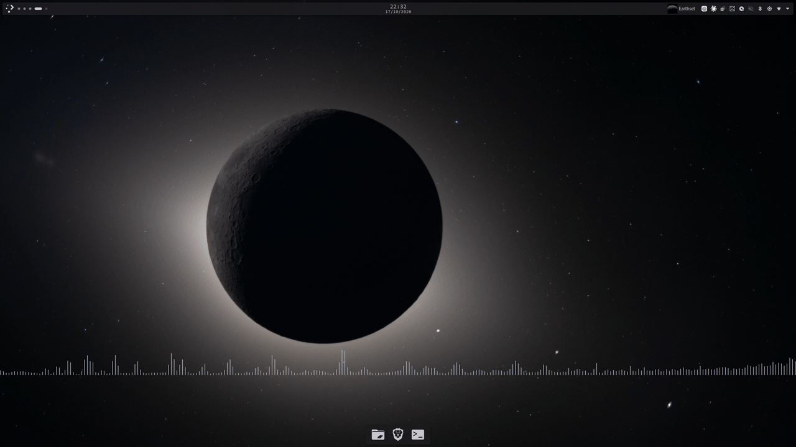

# Artemis for Kubuntu

A basic monochrome lunar preset for KDE Plasma 6, built around NASA's Artemis II photography. Based on [KDE Artemis on r/unixporn](https://www.reddit.com/r/unixporn/comments/1shnpz9/kde_artemis/).





## What it sets up

| Component | Configuration |
| --- | --- |
| Colors | Breeze with dark Material You colors generated from the wallpaper |
| Icons | YAMIS, outlined variants |
| Window decoration | Graphite-dark-round with subdued outlines |
| Tiling | Krohnkite with 16 px gutters around the floating panels, across five virtual desktops |
| Fonts | Source Sans 3 for the interface, Source Code Pro for terminals and the panel clock |
| Panels | Floating top bar with clickable workspace dots, a centered clock, media controls, and the system tray, plus a floating dock |
| Visualizer | Kurve with thin monochrome CAVA bars, hidden when no audio plays |
| Terminal | Konsole profile and an `artemis-fetch` Fastfetch preset |

## Requirements

- Kubuntu 26.04 on x86_64 with Plasma 6.6 and Python 3.14.
- An active Plasma session, X11 or Wayland.
- Internet access for the first `prepare.py` run.

Nothing is installed system-wide and `sudo` is never used. Assets go under `~/.local`, and startup configuration goes under `~/.config`.

## Install

```sh
python3 scripts/prepare.py        # download pinned themes, fonts, wallpapers, and runtime packages
python3 scripts/apply.py --check  # verify prerequisites without changing anything
python3 scripts/apply.py          # back up the current look, install, and activate
```

`apply.py` replaces the panel layout and restarts Plasma. Open windows stay open. It refuses to run a second time while a restore point exists.

## Customize

- Edit `scripts/layout.js` to change panel geometry or the pinned dock apps before you install.
- Change color generation in the **KDE Material You Colors** widget or in `~/.config/kde-material-you-colors/config.conf`.
- Adjust font sizes in **System Settings > Colors & Themes > Fonts**.
- Change tiling layouts, gaps, and floating windows in **System Settings > Window Management > KWin Scripts > Krohnkite**.

### Tiling keys

The keys match the komorebi setup of the Windows rice. H, J, K, L mean left, down, up, right. Meta
keys keep their Plasma defaults.

| Keys | Action |
| --- | --- |
| Alt+H / J / K / L | Move focus to the window in that direction |
| Alt+Shift+H / J / K / L | Move the focused window in that direction |
| Alt+1 … 5 | Switch to desktop 1 to 5 |
| Alt+Shift+1 … 5 | Send the focused window to that desktop |
| Alt+T | Float the focused window, or put it back in the tiling |
| Alt+Shift+F | Monocle: the focused window fills the desktop, press again to undo |
| Alt++ / Alt+- | Grow or shrink the focused window horizontally (add Shift for vertically) |
| Alt+X / Alt+Y | Rotate the layout, or the part holding the focused window |
| Alt+Q / Alt+M | Close or minimise the focused window |
| Alt+Shift+R | Re-tile into the tile layout, if the layout looks wrong |
| Alt+P | Float every window on the desktop, press again to tile them |

Komorebi keys without an equivalent here: Alt+Shift+Enter, because KDE cannot bind Enter on X11, the
stacking keys (Alt+Arrow, Alt+;, Alt+[ and Alt+]), Alt+I, and Alt+O. Alt+X and Alt+Y rotate by 90°
instead of mirroring, so two presses of Alt+X mirror the layout.

## Restore

```sh
python3 scripts/restore.py
```

This stops the color service, restores every file the installer changed, and restarts Plasma. The restore point lives in `backups/` inside your checkout, so keep the checkout until you no longer need it.

## Credits

| Asset | Source |
| --- | --- |
| Original rice | [KDE Artemis on r/unixporn](https://www.reddit.com/r/unixporn/comments/1shnpz9/kde_artemis/) |
| Color generation | [KDE Material You Colors](https://github.com/luisbocanegra/kde-material-you-colors) |
| Icons | [Yet Another Monochrome Icon Set](https://bitbucket.org/dirn-typo/yet-another-monochrome-icon-set) by Dirn |
| Window decoration | [Graphite KDE theme](https://github.com/vinceliuice/Graphite-kde-theme) by vinceliuice |
| Tiling | [Krohnkite](https://codeberg.org/anametologin/Krohnkite) |
| Audio visualizer | [Kurve](https://github.com/luisbocanegra/kurve) and [CAVA](https://github.com/karlstav/cava) |
| Fonts | [Source Sans 3](https://github.com/adobe-fonts/source-sans) and [Source Code Pro](https://github.com/adobe-fonts/source-code-pro) by Adobe |
| Desktop wallpaper | NASA, [Artemis II in Eclipse (art002e009301)](https://images.nasa.gov/details/art002e009301) |
| Lock screen wallpaper | NASA, [A New View of the Moon (art002e009287)](https://images.nasa.gov/details/art002e009287) |

The scripts are released under the [MIT License](LICENSE). Third-party assets keep their upstream licenses. They are downloaded at pinned revisions by `scripts/prepare.py`, not stored in this repository.
